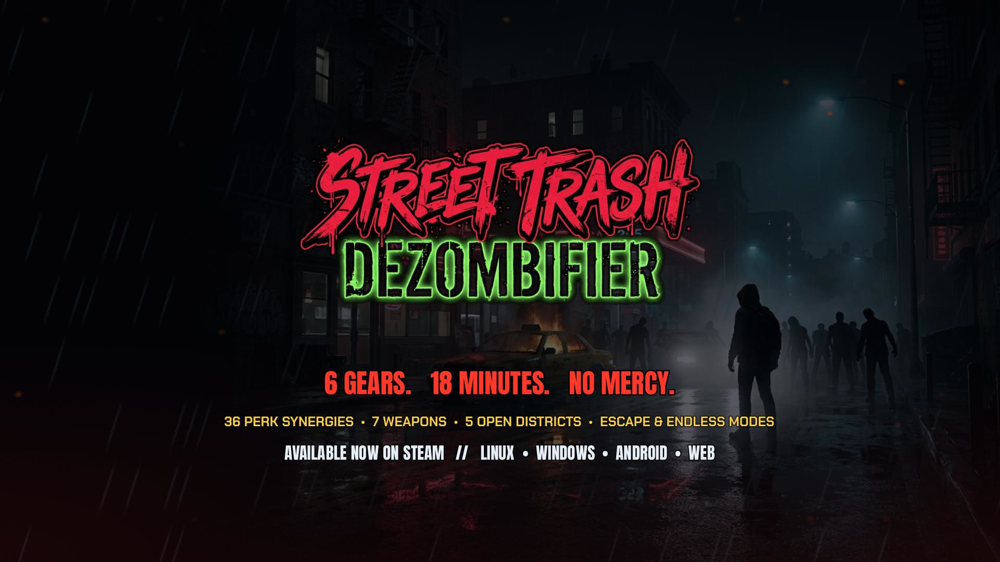
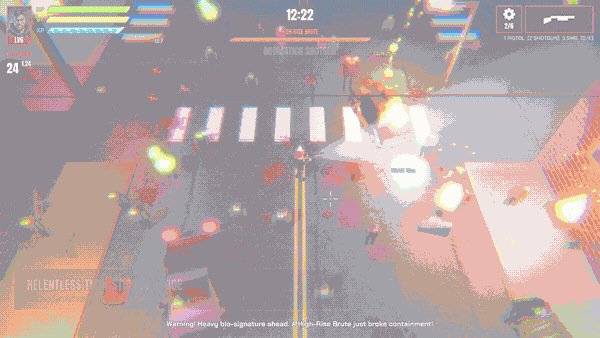
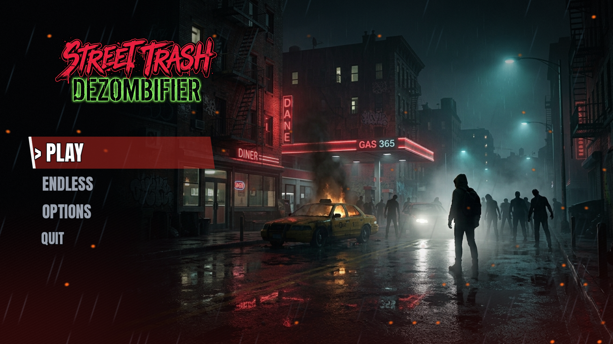
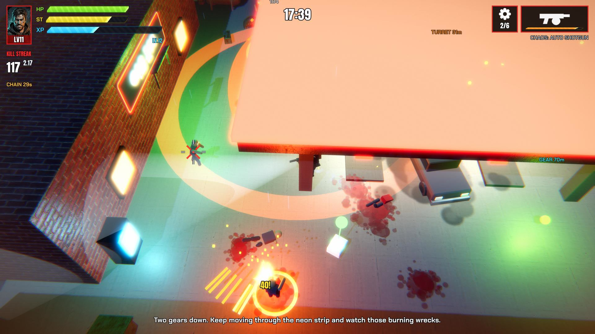
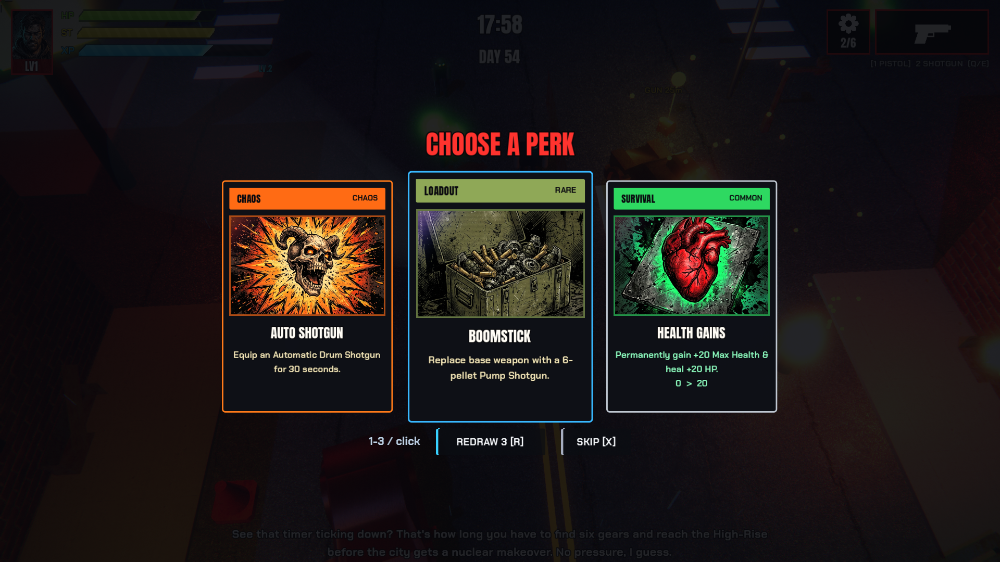
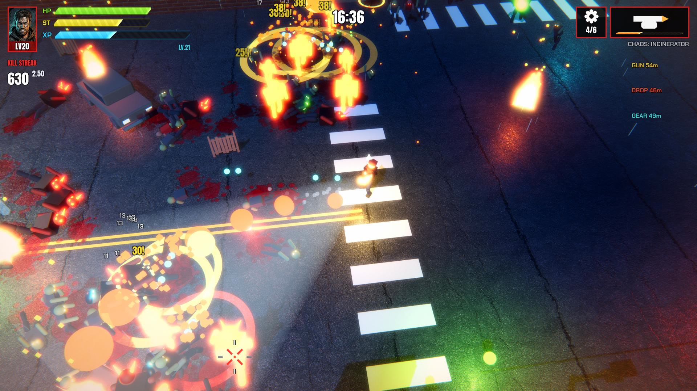
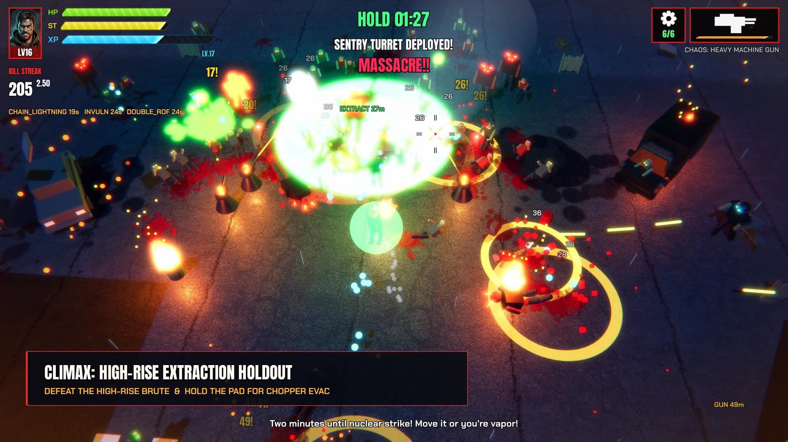
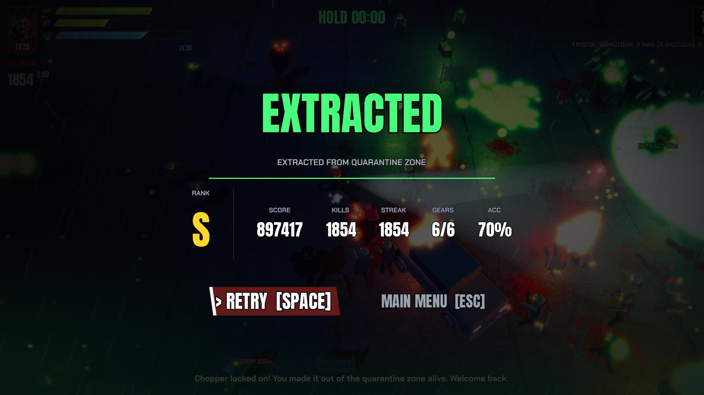

<div align="center">



# Street Trash: Dezombifier

**A playable 3D remake of the zombie arcade mini-game from Jason's house in GTA 6 — built from a gameplay video using Godot 4.**

[](https://github.com/Twarga/Street-Trash-III-Dezombifie-Clone-/releases/download/v1.0.0/StreetTrashDezombifier.x86_64)
[](https://github.com/Twarga/Street-Trash-III-Dezombifie-Clone-/releases/download/v1.0.0/StreetTrashDezombifier.exe)
[](https://github.com/Twarga/Street-Trash-III-Dezombifie-Clone-/releases/download/v1.0.0/StreetTrashDezombifier.apk)
[](https://godotengine.org/)

</div>

---

## Gameplay Preview

<div align="center">



*(Full 1080p60 trailer with sound is also in the repo at [`docs/media/trailer_1080p60.mp4`](docs/media/trailer_1080p60.mp4))*

</div>

---

## Screenshots

| **Main Menu & Loadout Setup** | **GAS 365 Station Shootout** |
| :---: | :---: |
|  |  |
| **Level-Up Perk Cards** | **Flamethrower vs. Night Horde** |
|  |  |
| **High-Rise Boss & Sentry Turrets** | **Extraction Holdout & S-Rank Clear** |
|  |  |

---

## About the Project

While watching GTA 6 footage, there is a playable retro-console zombie game inside Jason's house called ***Street Trash: Dezombifier***. I wanted to play it for real, so I fed the gameplay video into **Antigravity (Gemini 4 Neon)** and asked it to recreate the whole game from scratch in Godot 4.

### What's Inside
- **The Goal:** You have **18 minutes** before the city gets nuked. Fight through the streets, find **6 Gears**, and survive a **90-second holdout** at the High-Rise evacuation pad.
- **2 Game Modes:** **Quarantine Escape** (18-minute campaign) and **Endless Outbreak** (infinite survival waves).
- **7 Weapons:** *9mm Street Pistol*, *Boomstick Shotgun*, *Pocket Capper SMG*, *Street Sweeper Rifle*, plus temporary **Chaos Overrides** (*Heavy Machine Gun*, *Auto Shotgun*, and *Incinerator Flamethrower*).
- **36 Perk Cards:** Level up mid-fight and draft 3 comic-style perk cards — stack fire rate, ricochet bullets, piercing slugs, shockwave dashes, or risk/reward **Duality** perks (*Vampire*, *Glass Cannon*, *Blood Fuel*).
- **7 Zombie Types:** *Shamblers*, fast red-eyed *Sprinters*, armored *Riot Bruisers*, exploding *Acid Bloaters*, ranged *Toxic Spitters*, horned *Bull Chargers*, and the giant **High-Rise Brute Boss**.
- **5 City Districts:** *Main Avenue*, *GAS 365 Station* (with chain-exploding fuel pumps), *Neon Alley Courtyard*, *Subway Military Checkpoint*, *Industrial Cargo Yard*, and the *High-Rise Plaza*.

---

## Controls

| Action | Keyboard & Mouse | Gamepad (Twin-Stick) | Android / Touch |
| :--- | :--- | :--- | :--- |
| **Move** | `W A S D` | `Left Stick` | Left Virtual Stick |
| **Aim & Shoot** | `Mouse` + `Left Click` | `Right Stick` | Right Virtual Stick |
| **Sprint** | `Left Shift` | `L3` | Sprint Button |
| **Dash / Shove** | `Space` | `LB / RB` | Dash Button |
| **Switch Weapon** | `1–6`, `Q / E`, `Scroll`, or `Right Click` | `LB / RB` | Weapon Slot Tap |
| **Pick Perk Card** | `Click` or `1 / 2 / 3` (`R` Redraw, `X` Skip) | `D-Pad` + `A / X / B` | Tap Card |
| **Fullscreen / Pause** | `F11` / `Esc` | `Start` | Pause Button |

---

## How to Play

### 1. Download a Ready-to-Play Build (No Engine Needed)
Grab the latest standalone build for your OS from the [**Releases Page**](https://github.com/Twarga/Street-Trash-III-Dezombifie-Clone-/releases/latest):
- **Linux (`StreetTrashDezombifier.x86_64`):**
  ```bash
  chmod +x StreetTrashDezombifier.x86_64
  ./StreetTrashDezombifier.x86_64
  ```
- **Windows (`StreetTrashDezombifier.exe`):** Double-click `StreetTrashDezombifier.exe` to play.
- **Android (`StreetTrashDezombifier.apk`):** Install the APK on any Android phone or tablet (includes built-in twin-stick touch controls).

### 2. Run from Source (Godot 4.6+)
```bash
git clone https://github.com/Twarga/Street-Trash-III-Dezombifie-Clone-.git
cd Street-Trash-III-Dezombifie-Clone-
godot --path .
```

---

## License

Released under the [MIT License](LICENSE).
